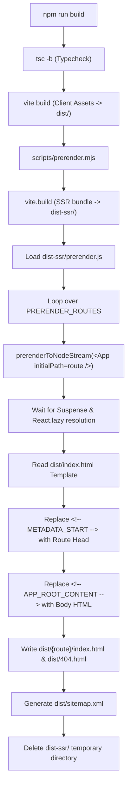

# Prerendering Architecture — AarogyaDamu
**Static Site Generation (SSG) with React 19 & Vite**

---

## 1. Architectural Strategy

The prerendering architecture for AarogyaDamu employs a dual-stage build sequence without introducing heavy full-stack frameworks (like Next.js) or third-party headless browser wrappers. It leverages:
1. **Vite's Native Client Build:** Standard bundling into `dist/`.
2. **Vite's Programmatic SSR Build:** Targeted compilation of `src/prerender.tsx` into a temporary `dist-ssr/` directory.
3. **React 19 Static Streaming:** `prerenderToNodeStream` from `react-dom/static`.
4. **Deterministic Template Injection:** Explicit delimiter comment markers rather than volatile regular expression lookarounds.



---

## 2. React 19 Static Streaming (`prerenderToNodeStream`)

Standard `renderToString` from `react-dom/server` exhibits known limitations when combined with route-level `React.lazy()` and `<Suspense>` boundaries: it immediately throws or falls back to the loading placeholder.

React 19 introduces `prerenderToNodeStream` in `react-dom/static`. It suspends execution until all asynchronous promises (including dynamic `import()` chunks invoked by `React.lazy`) have settled.

```tsx
// src/prerender.tsx
export async function prerender(route: string): Promise<PrerenderResult> {
  const metadata = ROUTES_METADATA[route] || ROUTES_METADATA['/404'];

  const { prelude } = await prerenderToNodeStream(
    <React.StrictMode>
      <App initialPath={route} />
    </React.StrictMode>
  );

  let html = '';
  const stream = prelude as any;
  await new Promise<void>((resolve, reject) => {
    stream.on('data', (chunk: unknown) => {
      html += String(chunk);
    });
    stream.on('end', () => resolve());
    stream.on('error', (err: unknown) => reject(err));
  });

  return { html, metadata };
}
```

### Empirical Proof of Full Component Resolution
During build tests, each prerendered page was audited for the presence of the Suspense fallback marker (`aria-busy="true"`):
- `dist/index.html`: **83,594 bytes** — Complete hero, companion, intelligence, and journey sections.
- `dist/about/index.html`: **14,865 bytes** — `fallbackOnly=false` (Contains `"Building the Intelligence Layer"`).
- `dist/faq/index.html`: **19,395 bytes** — `fallbackOnly=false` (Contains all 6 verified Q&A blocks).
- `dist/contact/index.html`: **15,954 bytes** — `fallbackOnly=false` (Contains full semantic contact form).
- `dist/security/index.html`: **14,710 bytes** — `fallbackOnly=false` (Contains 6 security architecture sections).
- `dist/privacy/index.html`: **17,329 bytes** — `fallbackOnly=false` (Contains DPDP compliance policies).
- `dist/terms/index.html`: **14,293 bytes** — `fallbackOnly=false` (Contains clinical disclaimers).
- `dist/thank-you/index.html`: **12,636 bytes** — `fallbackOnly=false` (Contains confirmation layout).
- `dist/404.html`: **12,971 bytes** — `fallbackOnly=false` (Contains branded 404 alert & recovery links).

---

## 3. Client Hydration Strategy (`src/main.tsx`)

To avoid hydration mismatches, DOM flicker, or accidental replacement of server-rendered markup:

```tsx
// src/main.tsx
import React from 'react';
import ReactDOM from 'react-dom/client';
import App from './App';
import './index.css';

const rootElement = document.getElementById('root');

if (rootElement && rootElement.hasChildNodes()) {
  ReactDOM.hydrateRoot(
    rootElement,
    <React.StrictMode>
      <App />
    </React.StrictMode>,
  );
} else if (rootElement) {
  ReactDOM.createRoot(rootElement).render(
    <React.StrictMode>
      <App />
    </React.StrictMode>,
  );
}
```

### In-Browser Mechanics
1. **Static Initial Load:** When a crawler or browser fetches any URL, `#root` already contains the full DOM tree emitted by `prerenderToNodeStream`.
2. **Hydration Phase:** `rootElement.hasChildNodes()` evaluates to `true`. `ReactDOM.hydrateRoot()` binds event listeners to the existing DOM nodes without wiping or re-rendering them.
3. **Development / Fallback Phase:** In `npm run dev` or when loading an empty container, `rootElement.hasChildNodes()` evaluates to `false`, engaging `ReactDOM.createRoot()` cleanly.

---

## 4. Single Source of Truth Route Registry

`src/lib/routes.ts` defines all canonical and utility routes, ensuring identical configuration across the build pipeline and client runtime.

```ts
// src/lib/routes.ts
export interface RouteMetadata {
  path: string;
  title: string;
  description: string;
  canonicalUrl: string;
  robots: string;
  ogImage: string;
  breadcrumbs?: BreadcrumbEntry[];
  isCanonicalIndexable: boolean;
  sourceFile: string;
  schemaJson: object;
}
```

Both `src/prerender.tsx` and each page component (e.g. `HomePage.tsx`, `AboutPage.tsx`, `FaqPage.tsx`) consume this single definition, preventing any desynchronization between HTML responses and client-side page title/meta updates.

